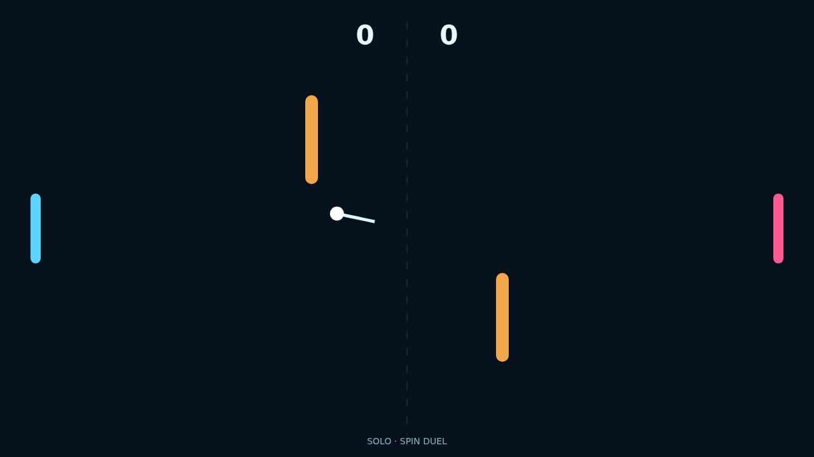

# Carom

Carom starts with a clean serve across a midnight table: one bright ball, two vivid paddles, and a pair of amber rails waiting to turn a simple return into a clever bank shot.

Each strike carries the motion of your paddle into the ball. Slide upward or downward at contact and the rally bends into a satisfying arc, turning a defensive save into an unexpected curve around an obstacle.

Play Solo to test your touch against a responsive opponent, or settle in for local Versus with a friend on the same keyboard. Every point resets the board and raises the pressure until somebody wins by two.

